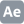
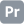
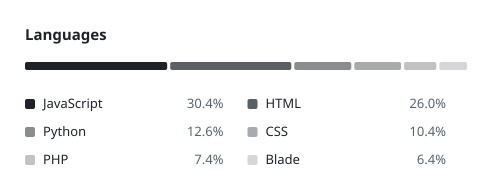

<!-- The original design is on the readme-backup branch. Hero and icons are built by profile/src/build_svgs.py -->

<picture>
  <source media="(prefers-color-scheme: dark)" srcset="./profile/hero-dark.svg">
  <source media="(prefers-color-scheme: light)" srcset="./profile/hero-light.svg">
  
</picture>

Front-end developer and electrical engineering student. I've been editing video for 7+ years.

 

<b>Right now</b>

  Learning offensive security, working through VulnHub boxes 
  Building a small home lab 
  Building a premium developer portfolio with Next.js and Tailwind

 

<b>Tools</b>

   &emsp;  &emsp;  &emsp;  &emsp;  &emsp;   
   &emsp;  &emsp;  &emsp;  &emsp;  &emsp;  &emsp;   
   &emsp;  &emsp;  &emsp;  &emsp; 

 

   &emsp;  &emsp;  &emsp;  &emsp;  &emsp; 

 

  <picture>
    <source media="(prefers-color-scheme: dark)" srcset="./profile/activity-graph-dark.svg">
    <source media="(prefers-color-scheme: light)" srcset="./profile/activity-graph-light.svg">
    
  </picture>

  <picture>
    <source media="(prefers-color-scheme: dark)" srcset="./profile/streak-dark.svg">
    <source media="(prefers-color-scheme: light)" srcset="./profile/streak-light.svg">
    
  </picture>
  <picture>
    <source media="(prefers-color-scheme: dark)" srcset="./profile/langs-dark.svg">
    <source media="(prefers-color-scheme: light)" srcset="./profile/langs-light.svg">
    
  </picture>

<picture>
  <source media="(prefers-color-scheme: dark)" srcset="https://raw.githubusercontent.com/IridescentGlow/IridescentGlow/output/pacman-contribution-graph-dark.svg">
  <source media="(prefers-color-scheme: light)" srcset="https://raw.githubusercontent.com/IridescentGlow/IridescentGlow/output/pacman-contribution-graph.svg">
  
</picture>

  

<b>Featured</b>

  <a href="https://github.com/IridescentGlow/hyprland-dotfiles">
  <picture>
    <source media="(prefers-color-scheme: dark)" srcset="./profile/pin-hyprland-dotfiles-dark.svg">
    <source media="(prefers-color-scheme: light)" srcset="./profile/pin-hyprland-dotfiles-light.svg">
    
  </picture>
  </a>
  <a href="https://github.com/ellay21/Medihelp-Frontend">
  <picture>
    <source media="(prefers-color-scheme: dark)" srcset="./profile/pin-medihelp-frontend-dark.svg">
    <source media="(prefers-color-scheme: light)" srcset="./profile/pin-medihelp-frontend-light.svg">
    
  </picture>
  </a>

 

  <a href="https://ko-fi.com/edibledank">
  <picture>
    <source media="(prefers-color-scheme: dark)" srcset="./profile/kofi-dark.svg">
    <source media="(prefers-color-scheme: light)" srcset="./profile/kofi-light.svg">
    
  </picture>
  </a>

