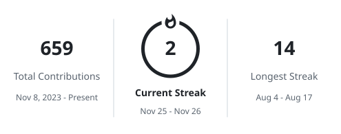

<!-- The original design is on the readme-backup branch. The hero is built by profile/src/build_svgs.py -->

<picture>
  <source media="(prefers-color-scheme: dark)" srcset="./profile/hero-dark.svg">
  <source media="(prefers-color-scheme: light)" srcset="./profile/hero-light.svg">
  
</picture>

Front-end developer and electrical engineering student. I've been editing video for 7+ years.

**Right now**

- Learning offensive security, working through VulnHub boxes
- Building a small home lab
- Building a premium developer portfolio with Next.js and Tailwind

**Tools**

React, Next.js, JavaScript, Tailwind, CSS, Vite\
Python, C++, Java, Git, Linux on Arch with Hyprland\
Figma, Photoshop, After Effects, Premiere Pro, Ableton Live

**Elsewhere**

[LinkedIn](https://www.linkedin.com/in/edible-dank-84932233b/) &ensp; [Telegram](https://t.me/Lumianara) &ensp; [Instagram](https://www.instagram.com/phazotron_) &ensp; [Email](mailto:contactphazotron@gmail.com) &ensp; [Discord](https://discord.com/users/1529829388353409064) &ensp; [Ko-fi](https://ko-fi.com/edibledank)

 

<picture>
  <source media="(prefers-color-scheme: dark)" srcset="./profile/activity-graph-dark.svg">
  <source media="(prefers-color-scheme: light)" srcset="./profile/activity-graph-light.svg">
  
</picture>

<picture>
  <source media="(prefers-color-scheme: dark)" srcset="./profile/streak-dark.svg">
  <source media="(prefers-color-scheme: light)" srcset="./profile/streak-light.svg">
  
</picture>

<picture>
  <source media="(prefers-color-scheme: dark)" srcset="https://raw.githubusercontent.com/IridescentGlow/IridescentGlow/output/pacman-contribution-graph-dark.svg">
  <source media="(prefers-color-scheme: light)" srcset="https://raw.githubusercontent.com/IridescentGlow/IridescentGlow/output/pacman-contribution-graph.svg">
  
</picture>

 

**Featured**

<a href="https://github.com/IridescentGlow/hyprland-dotfiles">
  <picture>
    <source media="(prefers-color-scheme: dark)" srcset="./profile/pin-hyprland-dotfiles-dark.svg">
    <source media="(prefers-color-scheme: light)" srcset="./profile/pin-hyprland-dotfiles-light.svg">
    
  </picture>
</a>
<a href="https://github.com/ellay21/Medihelp-Frontend">
  <picture>
    <source media="(prefers-color-scheme: dark)" srcset="./profile/pin-medihelp-frontend-dark.svg">
    <source media="(prefers-color-scheme: light)" srcset="./profile/pin-medihelp-frontend-light.svg">
    
  </picture>
</a>
