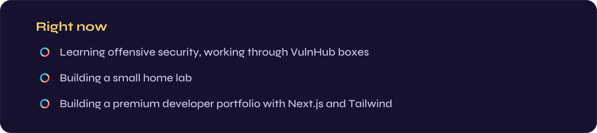
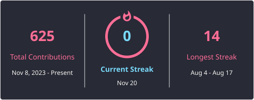

<!-- Previous design lives on the readme-backup branch. Hand-made SVGs are built by profile/src/build_svgs.py -->

 

  

  
  
  
  
  
  

  

  

 

  
  

  

<picture>
  <source media="(prefers-color-scheme: dark)" srcset="https://raw.githubusercontent.com/IridescentGlow/IridescentGlow/output/pacman-contribution-graph-dark.svg">
  <source media="(prefers-color-scheme: light)" srcset="https://raw.githubusercontent.com/IridescentGlow/IridescentGlow/output/pacman-contribution-graph.svg">
  
</picture>

  

  
  

 

  

